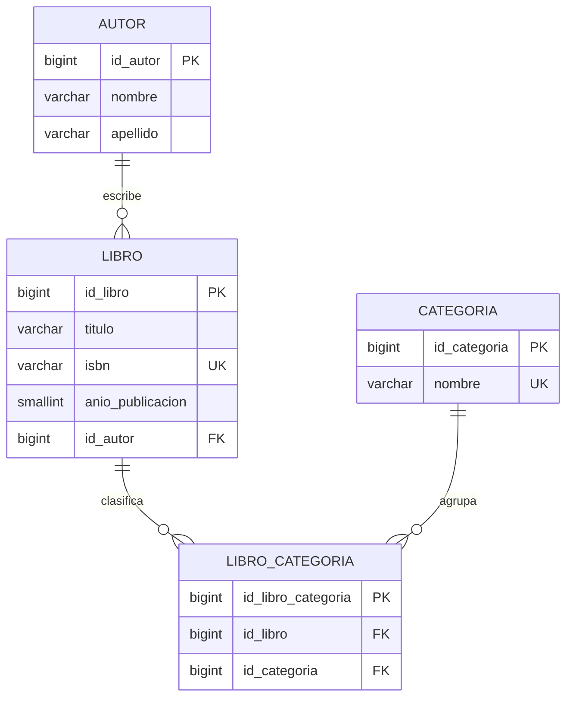
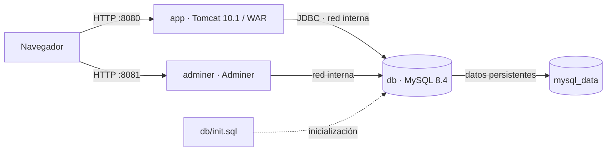

# Biblioteca

Aplicación web para administrar un catálogo de biblioteca: libros, autores y categorías. Está desarrollada con Java 17, Jakarta Servlet 6 y Maven, y se despliega como un WAR en Tomcat 10.1. La interfaz web consume una API REST y la persistencia se realiza en MySQL mediante JDBC.

## Modelo de datos



Cada libro pertenece a un autor. Los libros y las categorías tienen una relación muchos a muchos, implementada mediante `libro_categoria`.

## Arquitectura de contenedores



Compose construye la aplicación desde el `Dockerfile`, espera a que MySQL esté saludable y conecta los servicios a la red `biblioteca-interna`. La base de datos no publica un puerto en el host. El volumen `mysql_data` conserva los datos entre reinicios; `db/init.sql` se ejecuta al inicializar un volumen vacío.

## Requisitos

- Docker Engine y el complemento Docker Compose.
- Puertos `8080` y `8081` disponibles en el host.

## Configuración y ejecución

1. Copia el archivo de ejemplo:

   ```powershell
   Copy-Item .env.example .env
   ```

   En Linux o macOS puedes usar `cp .env.example .env`.

2. Edita `.env` y sustituye las contraseñas de ejemplo por valores propios. Mantén `DB_NAME=biblioteca` si no vas a cambiar también el nombre de la base de datos en `db/init.sql`.

3. Desde la raíz del proyecto, construye y arranca los servicios:

   ```shell
   docker compose up --build -d
   ```

4. Abre la aplicación en <http://localhost:8080/>. Adminer está disponible en <http://localhost:8081/>.

Para revisar el estado utiliza `docker compose ps`; para consultar los registros, `docker compose logs -f app db`. Para detener los contenedores sin borrar los datos, ejecuta `docker compose down`.

## Variables de entorno

| Variable | Uso | Valor del archivo de ejemplo |
| --- | --- | --- |
| `DB_NAME` | Nombre de la base de datos MySQL. | `biblioteca` |
| `DB_USER` | Usuario de la aplicación y Adminer. | `biblioteca` |
| `DB_PASSWORD` | Contraseña de ese usuario; Compose también la inyecta como `DB_PASSWORD` en la aplicación. | `cambiar_esta_contrasena` |
| `DB_ROOT_PASSWORD` | Contraseña del usuario `root` de MySQL. | `cambiar_esta_contrasena_root` |
| `DB_URL` | URL JDBC que Compose construye para la aplicación con `DB_NAME` y el host de servicio `db`. No se define en `.env`. | `jdbc:mysql://db:3306/biblioteca?useSSL=false&allowPublicKeyRetrieval=true&serverTimezone=UTC` |

`DB_URL`, `DB_USER` y `DB_PASSWORD` son las variables de conexión que lee la aplicación. No guardes el archivo `.env` en el control de versiones ni uses las contraseñas de ejemplo en un despliegue real.

## Puertos expuestos

| Servicio | Dirección desde el host | Uso |
| --- | --- | --- |
| Aplicación | `http://localhost:8080/` | Interfaz web y API REST. |
| Adminer | `http://localhost:8081/` | Administración de MySQL. |
| MySQL | Sin puerto publicado | Accesible para `app` y `adminer` dentro de la red de Compose. |

## Credenciales y datos de prueba

La interfaz web no requiere iniciar sesión. Para conectar Adminer, selecciona el sistema `MySQL` y usa:

| Campo | Valor |
| --- | --- |
| Servidor | `db` |
| Base de datos | `biblioteca` |
| Usuario | El valor de `DB_USER` en `.env` (por defecto, `biblioteca`). |
| Contraseña | El valor de `DB_PASSWORD` en `.env` (por defecto, `cambiar_esta_contrasena`). |

También puedes usar el usuario `root` con la contraseña definida en `DB_ROOT_PASSWORD`. Los datos iniciales incluyen 5 autores, 10 libros y 5 categorías; por ejemplo, Miguel de Cervantes, Jane Austen, *Don Quijote de la Mancha* y *Orgullo y prejuicio*. Cambiar o eliminar los datos en `.env` no modifica un volumen MySQL ya inicializado. Para volver a cargar el esquema y los datos iniciales habría que recrear el volumen `mysql_data`, lo que elimina los datos almacenados.

## Estructura del proyecto

```text
.
├── db/
│   └── init.sql
├── src/
│   ├── main/
│   │   ├── java/com/biblioteca/
│   │   │   ├── config/       # DataSource y ciclo de vida de la aplicación
│   │   │   ├── controller/   # Servlets REST
│   │   │   ├── dao/          # Interfaces y acceso JDBC
│   │   │   ├── dto/          # Objetos de transferencia
│   │   │   ├── exception/    # Excepciones de la aplicación
│   │   │   ├── model/        # Modelos
│   │   │   └── service/      # Reglas y validaciones
│   │   └── webapp/
│   │       ├── css/
│   │       ├── js/
│   │       ├── WEB-INF/
│   │       └── index.html
│   └── test/
│       ├── java/com/biblioteca/ # Pruebas de DAO, servicios y Servlets
│       └── resources/schema.sql
├── .env.example
├── Dockerfile
├── docker-compose.yml
└── pom.xml
```

El flujo de la aplicación sigue las capas `Servlet → Service → DAO → base de datos`; los DTOs se usan para intercambiar datos entre capas.

## Uso de la aplicación

1. Abre la sección **Libros** para consultar el catálogo. Usa el formulario para crear un libro con título, ISBN, año, autor y, opcionalmente, una o varias categorías.
2. Selecciona la acción de edición de un libro para cargar sus datos en el formulario, modifícalos y guarda los cambios. La acción de borrar solicita confirmación.
3. En **Autores** y **Categorías**, consulta los registros y usa sus formularios para crear o editar. Los autores asociados a libros no se pueden borrar.
4. La interfaz muestra **Cargando...** durante las peticiones y comunica errores de validación, duplicados o del servidor.

La API REST está disponible en `/api/autores`, `/api/libros` y `/api/categorias`. Cada recurso admite `GET` para listar y consultar por identificador, además de `POST`, `PUT` y `DELETE` para las operaciones CRUD.